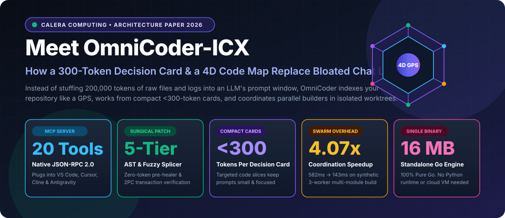
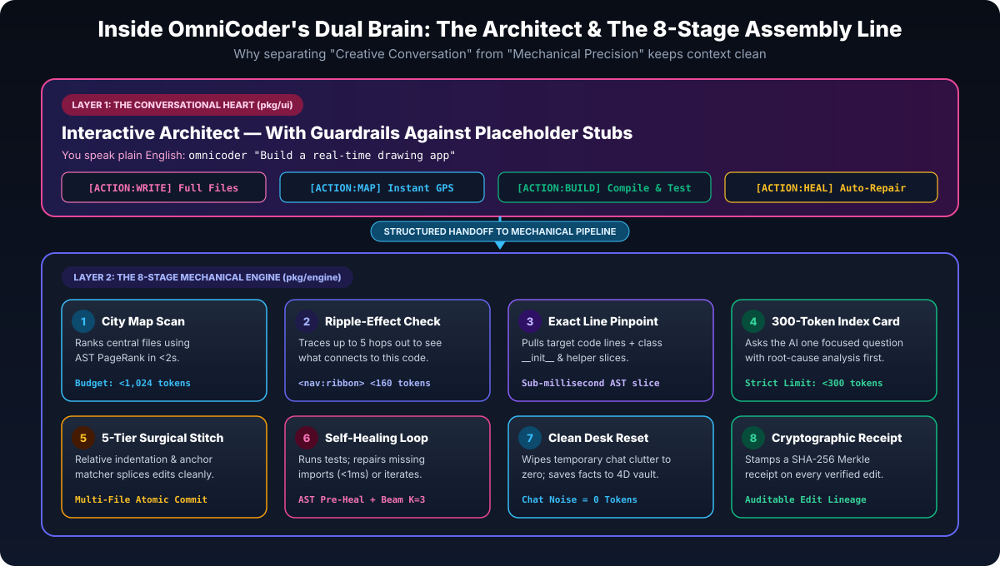

# OmniCoder-ICX



**OmniCoder-ICX** is a standalone, zero-CGo autonomous software engineering engine and **Model Context Protocol (MCP)** server written in pure Go.

Instead of pouring 100,000+ tokens of raw files and stale shell transcripts into an ever-growing chat window, OmniCoder-ICX separates **remembering** from **reasoning**:
1. **0D–4D Repository Lattice (`pkg/icx`, `pkg/devops`, `pkg/storage/titankv`)**: Indexes AST symbols, call graphs, blast-radius dependencies (`<nav:ribbon>`), and cryptographic actuation receipts outside the LLM context window.
2. **`< 300`-Token Micro-Decision Cards (`pkg/llm/cards.go`)**: Feeds the model only the localized code slice, intra-file call-graph helpers, and compiler/pytest diagnostics—then **wipes the prompt window clean** between turns.
3. **Dual Execution Architecture (`pkg/ui`, `pkg/engine`, `pkg/orchestrator`)**: Combines an interactive **Conversational Heart** (`omnicoder chat` / `omnicoder "<task>"`), an **8-Stage Deterministic Subterranean Engine** (`omnicoder solve` / `omnicoder heal`), and a **Parallel Git-Worktree Swarm Forge** (`omnicoder swarm`).

📄 **Read the Full Architecture Paper:** [`docs/OMNICODER_PUBLIC_PRODUCT_PAPER.md`](docs/OMNICODER_PUBLIC_PRODUCT_PAPER.md)

---

## Key Capabilities

| Capability | Description | Core Package |
| :--- | :--- | :--- |
| **Sub-300 Token Decision Cards** | Enforces a `< 300`-token prompt budget per repair/edit turn (`~2,450–2,600` tokens/task total) with zero context drift. | [`pkg/llm`](pkg/llm) |
| **AST & SBFL Fault Localization** | Hybrid stack-trace, BM25 symbol ranking, and intra-file call-graph + `__init__` slicing. | [`pkg/devops`](pkg/devops) |
| **5-Tier Fuzzy Edit Splicer** | Exact, trailing-whitespace, indentation-relative, comment/ellipsis-relaxed, and AST-anchored `SEARCH/REPLACE` patching. | [`pkg/devops/editblock.go`](pkg/devops/editblock.go) |
| **Speculative Dual-Window Healing** | Evaluates primary and secondary symbol windows in parallel with deterministic Python `NameError` and Go import pre-healers. | [`pkg/engine`](pkg/engine) |
| **Parallel Worktree Swarm Forge** | Compiles multi-phase markdown plans into topological waves across isolated Git worktrees with Two-Phase Commit (2PC) verification (`4.07x` speedup). | [`pkg/orchestrator`](pkg/orchestrator) |
| **20-Tool Native MCP Server** | Drop-in JSON-RPC 2.0 stdio MCP server for Cursor, Cline, VS Code, Claude Code, and Antigravity with microVM CoW sandboxing. | [`pkg/mcp`](pkg/mcp) |
| **Embedded TitanKV Vault** | Pure-Go ACID key-value and WAL storage engine with Merkle-tree cryptographic audit seals. | [`pkg/storage/titankv`](pkg/storage/titankv) |



---

## Quickstart

### 1. Build from Source (Pure Go, Zero CGo)

Requires **Go 1.21+**. No C compiler or external system libraries are needed.

```bash
git clone https://github.com/Calera-Labs/omnicoder-icx.git
cd omnicoder-icx

# Build stripped standalone binary
CGO_ENABLED=0 go build -ldflags="-s -w" -trimpath -o bin/omnicoder ./cmd/omnicoder
```

On Windows (PowerShell), you can also build cross-platform release archives (`windows/amd64`, `linux/amd64`, `darwin/arm64`) with SHA-256 provenance manifests:

```powershell
powershell -ExecutionPolicy Bypass -File scripts\build_release.ps1
```

### 2. Configure Your LLM Backend

OmniCoder-ICX auto-discovers cloud APIs (Gemini, OpenAI, Anthropic) and local OpenAI-compatible servers (vLLM, Ollama, LM Studio, LocalAI):

```bash
# Option A: Google Gemini API
export GEMINI_API_KEY="your-api-key"

# Option B: Local vLLM / Ollama / LM Studio server
export OPENAI_BASE_URL="http://localhost:8000/v1"
export OMNICODER_MODEL="google/gemma-4-31B-it"
```

### 3. CLI Usage

```bash
# Interactive Conversational REPL ("The Heart")
omnicoder chat

# Direct natural-language project generation or bug fix
omnicoder "Build a thread-safe LRU cache with TTL and unit tests"

# Issue-only autonomous bug resolution (synthesizes reproducer + patches + verifies)
omnicoder solve --issue-file ISSUE.md --workspace ./repo

# Test-guided compiler/pytest self-healing loop
omnicoder heal --cmd "pytest -q" --max-turns 4

# Parallel multi-worktree Swarm Forge execution from a markdown build plan
omnicoder swarm docs/IMPLEMENTATION_PLAN.md --workers 3

# Workspace health, git status, and test gate oracle
omnicoder doctor
```

---

## MCP Server Configuration (Cursor / Cline / VS Code / Antigravity)

Add `omnicoder` to your MCP client configuration (`mcp_config.json` or `.mcp.json`):

```json
{
  "mcpServers": {
    "omnicoder": {
      "command": "/path/to/omnicoder",
      "args": ["mcp", "--trace"],
      "env": {
        "GEMINI_API_KEY": "your-api-key"
      }
    }
  }
}
```

### Exposed MCP Tools (20 Tools)
* **Orientation & Search:** `omnicoder_status`, `omnicoder_map` (AST PageRank repo map in `<2.0s`), `omnicoder_search` (symbol & receiver search), `omnicoder_doctor`
* **Surgical Editing & Self-Healing:** `omnicoder_patch` (5-tier fuzzy `SEARCH/REPLACE` & AST node replacement), `omnicoder_heal`, `omnicoder_refactor`
* **Sandboxed Execution & Swarm:** `omnicoder_sandbox` (isolated CoW microVM with compound shell chaining `&&`, `||`, `;`), `omnicoder_run`, `omnicoder_swarm`, `omnicoder_verify_service`
* **Workspace, Plan & Git Management:** `omnicoder_set_workspace`, `omnicoder_toggle_checklist`, `omnicoder_update_section`, `read_file`, `write_file`, `list_directory`, `git_status`, `git_diff`, `git_commit`

---

## Open-Core Architecture: Standalone vs. Calera ICX Enterprise

**OmniCoder-ICX** is designed as an **open-core engine**. Out of the box, it runs 100% standalone using an embedded, single-repo pure-Go fallback lattice (`pkg/icx/lattice.go` + `pkg/storage/titankv`).

When connected to a **Calera ICX** tenant ([https://icx.caleralabs.com](https://icx.caleralabs.com), via `ICX_API_KEY` & `X-Space-ID` in [`pkg/icx/client.go`](pkg/icx/client.go)), OmniCoder upgrades from a local single-repo tool into a **multi-repository, fleet-scale autonomous engineering platform**:

| Capability | **OmniCoder Standalone (Apache 2.0 Open-Source)** | **OmniCoder + Calera ICX ([icx.caleralabs.com](https://icx.caleralabs.com))** |
| :--- | :--- | :--- |
| **License** | Apache License 2.0 (OmniCoder without ICX) | Commercial / Enterprise License ([icx.caleralabs.com](https://icx.caleralabs.com)) |
| **Memory Substrate** | Local single-repo fallback cache & `.omnicoder/store` (`TitanKV`) | **Full Calera ICX 4D Volumetric Memory** with persistent cross-repo, org-wide epistemic memory (`X-Space-ID`) |
| **Fault Localization & Recall** | Local BM25 + intra-repo AST call-graph slicing | **Cross-Repo Causal Graph, Commit History & PR Changefeed Recall** (higher blind issue localization & reproducer synthesis) |
| **Live Enterprise Connectors** | Disabled locally (`ErrRemoteOnly` guard in [`pkg/icx/types.go`](pkg/icx/types.go)) | **Live Changefeed Connectors** (`github`, `jira`, `slack`, `salesforce`, CI/CD incident streams) |
| **Swarm Orchestration Scale** | Local Git worktrees on a single workstation (`1–4` workers) | **Distributed Cloud MicroVM Swarm Fleet (`64+` parallel workers)** with cross-machine CAS contract locking |
| **Cross-Team Shared Memory** | Ephemeral per-repo turn milestones | **Persistent Organization Memory** shared across engineering teams and CI pipelines |
| **Compliance & Provenance** | Local SHA-256 Merkle receipts | **Enterprise Cryptographic Audit Ledger** (`SyncAuditRecord` / SOC2 & ISO provenance attestation) |

To connect OmniCoder to a **Calera ICX** tenant ([https://icx.caleralabs.com](https://icx.caleralabs.com)):

```bash
export ICX_BASE_URL="https://icx.api.caleralabs.com/v1"
export ICX_API_KEY="icx_live_your_enterprise_key"
export ICX_SPACE_ID="org-production-lattice"
```

---

## Repository Structure

```text
omnicoder-icx/
├── cmd/omnicoder/       # Standalone CLI & MCP server entrypoint
├── pkg/
│   ├── canonical/       # Deterministic SHA-256 & Merkle proof computation
│   ├── devops/          # Fault localizer, 5-tier fuzzy splicer, AST repo map, doctor
│   ├── engine/          # 8-stage turn pipeline, speculative tournament, 2PC transactions
│   ├── icx/             # 0D-4D local memory cache, geodesic ribbons (<nav:ribbon>), actuation receipts
│   ├── llm/             # <300-token micro-decision cards & universal OpenAI/Gemini wire client
│   ├── mcp/             # JSON-RPC 2.0 stdio MCP server, auto-detection & JSONL audit tracer
│   ├── orchestrator/    # Parallel Git-worktree Swarm Forge & 2PC merge engine
│   ├── storage/titankv/ # Embedded pure-Go ACID key-value & WAL storage engine
│   ├── ui/              # Interactive terminal UI, bracketed paste & conversational build loop
│   └── vm/              # Hermetic Copy-on-Write sandbox & quote-aware shell-chaining engine
├── docs/                # Public architecture paper (Markdown & HTML) and SVG diagrams
└── scripts/             # Cross-platform release packager & validation suite
```

---

## Community, Security & Stewardship Governance

* **Contributing:** See [CONTRIBUTING.md](CONTRIBUTING.md) for cultural standards (*"Never Faking It"*), build, test, and pull request guidelines.
* **Security Policy:** See [SECURITY.md](SECURITY.md) for private vulnerability disclosure and sandbox containment architecture.
* **Code of Conduct & Stewardship Charter:** See [CODE_OF_CONDUCT.md](CODE_OF_CONDUCT.md) (**The Stewardship Doctrine / The Ezekiel Gate**).
* **Release History:** See [CHANGELOG.md](CHANGELOG.md).
* **Contact & Support:** **support@caleralabs.com**

---

## License & The Ezekiel Gate

* **OmniCoder Standalone (Without ICX):** The standalone OmniCoder CLI, local orchestration engine, MCP server, local fallback cache, and client connector interfaces in this repository are licensed under the [Apache License, Version 2.0](LICENSE) (see [NOTICE](NOTICE)).
* **Calera ICX Platform & Stewardship Qualification:** The **Calera ICX** platform, Volumetric Lattice Network (VLN) memory substrate, server engine, and associated IP are proprietary to **Calera Computing, Inc.** and are **not** licensed under Apache 2.0. Access and commercial licensing are governed exclusively by the licensing terms and **Stewardship Doctrine (*The Ezekiel Gate* — Ezekiel 3:17–18)** at **[https://icx.caleralabs.com](https://icx.caleralabs.com)** (**support@caleralabs.com**).

Copyright 2026 Calera Computing, Inc. (https://caleralabs.com | support@caleralabs.com).
