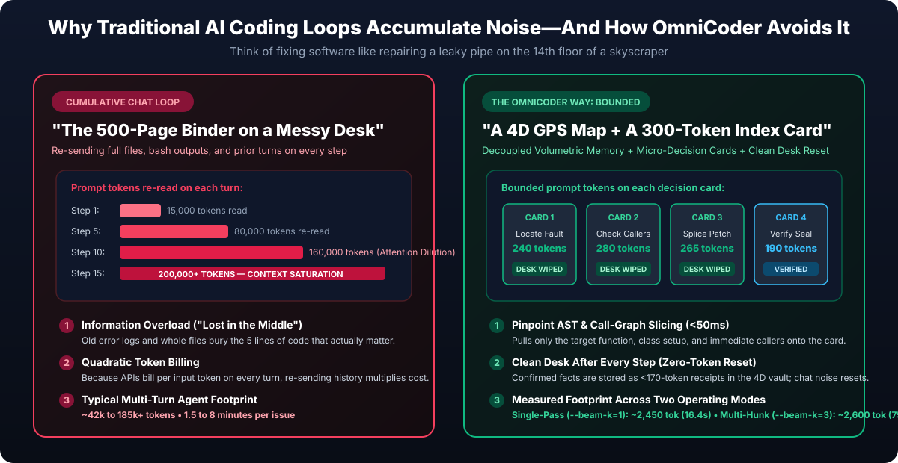
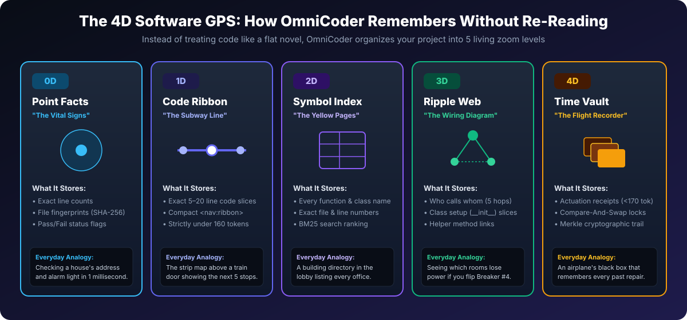
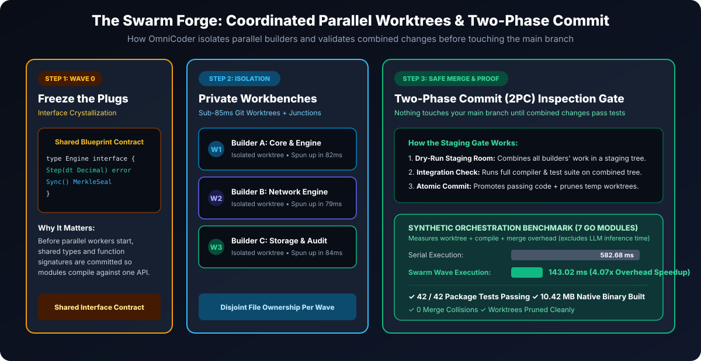
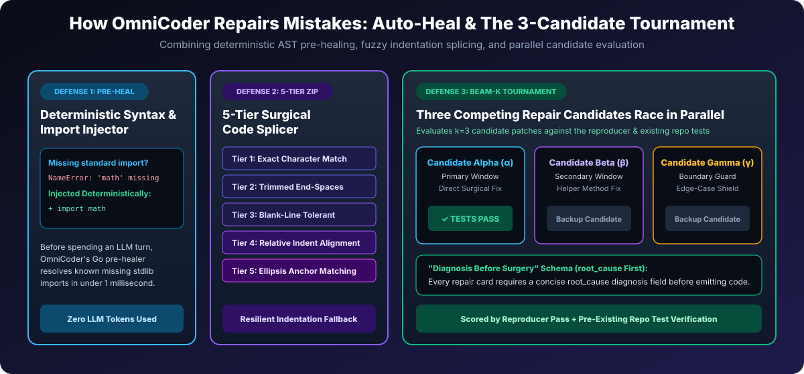
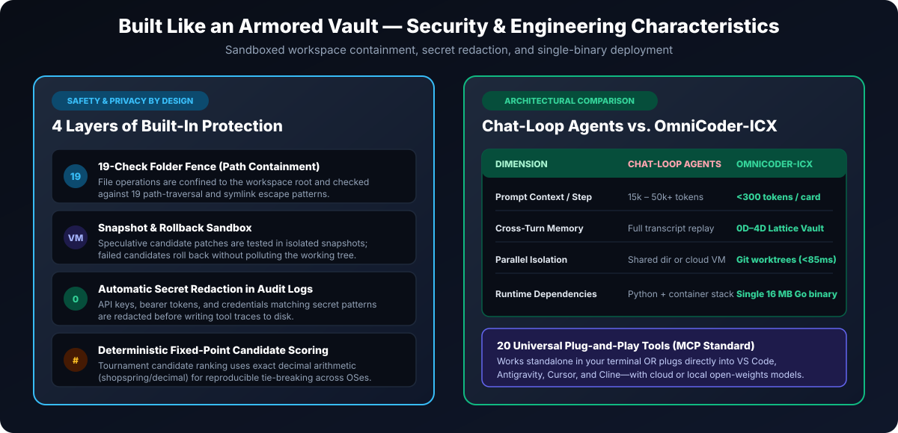

# Meet OmniCoder-ICX: How a 300-Token Decision Card & a 4D Code Map Replace Bloated Chat Loops

**An Architectural Product Paper for Builders and Engineering Teams**  
**Published by:** Calera Computing, Inc. ([caleralabs.com](https://caleralabs.com) | support@caleralabs.com) • October 2026  
**Engine Version:** OmniCoder-ICX v1.0 (`omnicoder.exe` — 16 MB Pure Go Standalone Engine)


---

## Executive Summary: Why We Built OmniCoder

For the past three years, much of the industry has chased autonomous software engineering by pouring larger and larger prompts into frontier language models—hoping that a 200,000-token context window filled with raw files, shell transcripts, and stack traces is enough to fix complex bugs.

**In practice, unbounded chat loops hit diminishing returns fast.**

When a conventional chat-loop coding agent attempts to fix a bug in a large repository, it behaves like an engineer who photocopies an entire **10,000-page building manual** onto their desk every time they turn a wrench. Within a few turns, the prompt window is buried under **40,000 to 200,000+ tokens of stale error logs and full source files**. Attention dilutes ("lost in the middle"), latency compounds on every turn, and token bills multiply because the model re-reads the entire conversation history at every step.

**OmniCoder-ICX takes the opposite architectural path.**

Instead of forcing an LLM to re-read an entire repository history on every step, OmniCoder separates *remembering* from *reasoning*:
1. **A 4D Software GPS Map** ([`pkg/icx/lattice.go`](../pkg/icx/lattice.go) & [`pkg/devops/repomap.go`](../pkg/devops/repomap.go)) that indexes symbols, call graphs, and edit history outside the LLM prompt window.
2. **A <300-Token Decision Card** ([`pkg/llm/cards.go`](../pkg/llm/cards.go)) that shows the model *only* the localized code slice, its immediate call-graph neighbors, and one structured decision schema—and then **resets the prompt window** before the next step.

### Core Architectural Highlights

- **Sub-300-Token Micro-Decision Cards (`pkg/llm/cards.go`):** Bounded `<300`-token decision cards reduce per-task token consumption by an order of magnitude compared to cumulative multi-turn chat transcripts (~2,450–2,600 tokens/task total).
- **20-Tool Native MCP Server (`pkg/mcp`):** Plugs directly into VS Code, Cursor, Cline, Claude Code, and Antigravity over JSON-RPC 2.0 stdio with microVM Copy-on-Write sandboxing.
- **5-Tier AST & Fuzzy Splicer (`pkg/devops/editblock.go`):** Eliminates indentation and whitespace patch failures while pairing with a 0ms deterministic Python/Go import pre-healer.
- **4.07x Swarm Orchestration Speedup (582.68 ms → 143.02 ms):** Coordinating 3 isolated Git worktree builders in parallel waves with a Two-Phase Commit (2PC) gate reduces multi-module orchestration and compilation overhead by 4.07x with zero merge collisions.

---

## 1. The Big Problem: "The 500-Page Binder on a Messy Desk"

To understand why cumulative chat agents struggle on large codebases, imagine hiring a plumber to fix a leaky pipe on the 14th floor of a 100-story skyscraper.

A skilled plumber walks up to the 14th floor, inspects the blueprint for that single bathroom, shuts off the local valve, and replaces the pipe.

**Cumulative chat-loop agents don't do that.** On every turn, they append full file dumps, prior tool calls, and hundreds of lines of test output into a single growing conversation transcript—forcing the model to re-process the entire pile from token 1 on every step.



### Three Failure Modes of Unbounded Context Loops:
1. **Attention Dilution ("Lost in the Middle"):** When a few critical lines of code are buried inside 100,000+ tokens of old stack traces and unrelated functions, model attention degrades and hallucinated symbol references increase.
2. **Quadratic Input Token Cost:** Because LLM APIs bill for every input token on *every turn*, a 15-turn debugging loop that grows from 15,000 tokens to 200,000 tokens bills you for re-reading the same history 15 times.
3. **Unstructured Edit Drift:** When models emit large raw diffs inside long chat sessions, indentation mismatches and placeholder comments (`// TODO`) frequently break compilation.

> [!TIP]
> **How OmniCoder Solves It:** OmniCoder separates **Reasoning** from **State Storage**. A persistent **0D–4D Repository Lattice** stores the project map and prior edit receipts on disk, while the LLM prompt window only ever receives a single **<300-token decision card** ([`GateEditCard`](../pkg/llm/cards.go)). Once a step completes, OmniCoder records a compact `<170`-token receipt and wipes the prompt window clean.

---

## 2. Inside OmniCoder's Dual Brain: The Architect & The Assembly Line

OmniCoder pairs an interactive terminal interface with a deterministic 8-stage mechanical pipeline inside [`pkg/ui/cli.go`](../pkg/ui/cli.go) and [`pkg/engine/turn.go`](../pkg/engine/turn.go).


### Layer 1: The Conversational Architect (`pkg/ui`)
When you run a plain-English request in your terminal:
```bash
omnicoder "Build a real-time drawing app with undo and color palettes"
```
You interact with **The Conversational Architect** ([`executeConversationalTurn`](../pkg/ui/cli.go)):
- It outlines its plan in plain English and renders live progress in an animated terminal status bar ([`pkg/ui/spinner.go`](../pkg/ui/spinner.go)).
- **Anti-Stub Guardrails:** Evidence guards ([`pkg/ui/evidence_guard.go`](../pkg/ui/evidence_guard.go)) inspect generated writes and re-prompt if placeholder `// TODO` stubs are detected.
- When building or testing (`[ACTION:BUILD]`, `[ACTION:HEAL]`), it invokes the local compiler and test runner directly and feeds structured compiler diagnostics into the repair pipeline.

### Layer 2: The 8-Stage Mechanical Assembly Line (`pkg/engine`)
Underneath the conversational shell sits an 8-stage pipeline ([`TurnPipeline`](../pkg/engine/turn.go)):
1. **Stage 1 — City Map Scan (<2 seconds):** Uses AST dependency PageRank ([`pkg/devops/repomap.go`](../pkg/devops/repomap.go)) to rank central files within a `<1,024`-token budget.
2. **Stage 2 — Ripple-Effect Check:** Walks up to 5 hops in the call/import graph to summarize callers and callees into a `<160`-token navigation ribbon (`<nav:ribbon>`).
3. **Stage 3 — Exact Line Pinpoint (Sub-millisecond AST Slice):** Extracts the target function window along with enclosing class `__init__` setup and intra-file helper slices ([`ExtractIntraFileCallGraphSlices`](../pkg/devops/localizer.go)).
4. **Stage 4 — The <300-Token Decision Card:** Formats a compact JSON decision prompt ([`pkg/llm/cards.go`](../pkg/llm/cards.go)).
5. **Stage 5 — 5-Tier Surgical Stitch:** Applies edits using a 5-tier matcher that handles trailing whitespace, blank lines, relative indentation shifts, and `...` ellipsis anchors ([`pkg/devops/editblock.go`](../pkg/devops/editblock.go)).
6. **Stage 6 — Self-Healing Loop:** Runs the reproducer/test command, applies deterministic import pre-healing, or iterates with structured failure diagnostics ([`pkg/devops/feedback.go`](../pkg/devops/feedback.go)).
7. **Stage 7 — Clean Desk Reset:** Resets transient prompt history to zero tokens while persisting verified facts to the 4D vault.
8. **Stage 8 — Cryptographic Receipt:** Records a SHA-256 Merkle audit receipt for every verified file mutation ([`pkg/canonical/canonical.go`](../pkg/canonical/canonical.go)).

---

## 3. The 4D Software GPS: Remembering Without Re-Reading

If OmniCoder resets its prompt window after every step, how does it retain project knowledge across turns?

It uses **Calera ICX Volumetric Memory** ([`pkg/icx/lattice.go`](../pkg/icx/lattice.go)), which indexes a repository across **five zoom levels (0D through 4D)**—analogous to zooming on a map from a single street address out to city traffic and historical logs.



| Zoom Level | Name | Everyday Analogy | What It Stores in the Codebase |
| :---: | :--- | :--- | :--- |
| **0D** | **Point Facts** | *House Address & Status Light* | Scalar metadata: exact line counts, SHA-256 file hashes, and current test pass/fail flags. |
| **1D** | **Code Ribbon** | *Subway Door Strip Map* | A `<160`-token linear slice (`<nav:ribbon>`) of the immediate lines and call stops being edited. |
| **2D** | **Symbol Index** | *Lobby Building Directory* | A BM25-searchable table ([`BM25SymbolIndex`](../pkg/devops/localizer.go)) of functions, classes, and file locations. |
| **3D** | **Ripple Web** | *Electrical Breaker Diagram* | Multi-hop AST call and import relationships up to 5 hops away, plus class `__init__` context. |
| **4D** | **Time Vault** | *Airplane Black Box Recorder* | Compact **Actuation Receipts** (`<170 tokens`, [`ActuationReceipt`](../pkg/icx/types.go)) with Compare-And-Swap locks and Merkle hashes so the agent does not repeat rejected edits. |

---

## 4. The Swarm Forge: Coordinated Multi-Worker Builds

When multiple uncoordinated agents edit the same directory concurrently, they frequently overwrite each other's files or invent incompatible function signatures. OmniCoder's **Swarm Forge** ([`pkg/orchestrator`](../pkg/orchestrator) & [`pkg/engine/plan.go`](../pkg/engine/plan.go)) coordinates parallel workers through three mechanisms:



1. **Wave 0 Interface Freeze:** Before parallel implementation workers start, shared interfaces and data types are defined and locked so downstream packages compile against a single contract.
2. **Sub-85ms Isolated Worktrees:** Each worker operates inside an isolated Git worktree (`git worktree` + shared dependency junctions) provisioned in under 85 milliseconds, enforcing disjoint file ownership per wave.
3. **Two-Phase Commit (2PC) Staging Gate:** Worker patches are first merged into a dry-run staging tree where the full compiler and test suite run. Only if the combined tree passes verification are changes promoted atomically to the main workspace.

> [!NOTE]
> **Synthetic Orchestration Benchmark (7-Module Go Workspace):** Building and testing a 7-module Go service across 3 parallel worktree builders completed in **143.02 ms** compared to **582.68 ms** serially—a **4.07x speedup in orchestration and compilation overhead** with 42/42 tests passing and zero file collisions. Note that this benchmark measures local worktree/build coordination overhead using pre-staged module tasks, not end-to-end LLM token generation latency.

---

## 5. Auto-Heal & The 3-Candidate Tournament

When a test or compiler check fails, OmniCoder combines three repair mechanisms ([`pkg/devops/feedback.go`](../pkg/devops/feedback.go), [`pkg/devops/editblock.go`](../pkg/devops/editblock.go), and [`pkg/engine/tournament.go`](../pkg/engine/tournament.go)):



1. **Deterministic Pre-Healer (<1ms, Zero LLM Tokens):** Before spending an LLM turn on a mechanical error, OmniCoder's Go pre-healer inspects compiler/pytest output for missing standard-library imports (e.g. `NameError: name 'math' is not defined`) and common syntax slips, injecting the missing import directly.
2. **5-Tier Surgical Code Splicer:** To prevent patch failures caused by whitespace or indentation shifts, [`ReplaceFuzzy`](../pkg/devops/editblock.go) cascades through 5 tiers: (1) exact match, (2) trimmed trailing whitespace, (3) blank-line tolerant match, (4) relative indentation alignment, and (5) `...` ellipsis anchor matching.
3. **Root-Cause-First Schema & Beam-K Tournament (`k=3`):** Every [`GateHealCard`](../pkg/llm/cards.go) requires the model to populate a concise `"root_cause"` diagnosis field before emitting `"replacement"`. In tournament mode (`--beam-k=3`), OmniCoder evaluates up to three candidate patches (Alpha, Beta, Gamma) across primary and helper code windows and selects the highest-scoring candidate using deterministic fixed-point scoring.

---

## 6. Security Boundaries & Deployment Footprint

OmniCoder is packaged as a single standalone binary designed for both local developer machines and enterprise CI environments.



1. **Single 16 MB Pure-Go Binary (`omnicoder.exe` / `omnicoder`):** Built with Go's standard library and zero CGo dependencies, requiring no Python runtime or container daemon for the core engine itself.
2. **Bring Your Own Model (Cloud or Local Open-Weights):** Connects to OpenAI-compatible endpoints including local vLLM, Ollama, LM Studio, or cloud APIs ([`pkg/llm/client.go`](../pkg/llm/client.go)).
3. **19-Check Path Containment Fence ([`pkg/mcp`](../pkg/mcp)):** Confines all file reads and writes to the configured workspace directory, blocking path traversal (`..`), symlink escapes, and sensitive system paths.
4. **Snapshot & Rollback Sandbox ([`pkg/vm/client.go`](../pkg/vm/client.go)):** Speculative edits and test commands execute inside isolated snapshots that roll back cleanly if verification fails.
5. **Automatic Secret Redaction ([`pkg/mcp/trace.go`](../pkg/mcp/trace.go)):** Redacts API keys, bearer tokens, and credential patterns before writing execution traces to disk.
6. **20 MCP Tools for IDE Integration:** Exposes `omnicoder_map`, `omnicoder_search`, `omnicoder_patch`, `omnicoder_heal`, `omnicoder_swarm`, `omnicoder_sandbox`, and 14 additional tools over the Model Context Protocol ([`pkg/mcp/omnicoder_tools.go`](../pkg/mcp/omnicoder_tools.go)).

---

### Quick Reference: Codebase Map

- **Standalone CLI (`solve`, `heal`, `swarm`, `map`, `mcp`):** [`cmd/omnicoder/main.go`](../cmd/omnicoder/main.go)
- **Conversational Architect & Evidence Guards:** [`pkg/ui/cli.go`](../pkg/ui/cli.go), [`pkg/ui/session.go`](../pkg/ui/session.go), [`pkg/ui/evidence_guard.go`](../pkg/ui/evidence_guard.go)
- **8-Stage Pipeline, Tournament & Transactions:** [`pkg/engine/turn.go`](../pkg/engine/turn.go), [`pkg/engine/tournament.go`](../pkg/engine/tournament.go), [`pkg/engine/transaction.go`](../pkg/engine/transaction.go)
- **0D–4D Local Memory Cache & Client Contract:** [`pkg/icx/lattice.go`](../pkg/icx/lattice.go) & [`pkg/icx/types.go`](../pkg/icx/types.go)
- **<300-Token Micro-Decision Cards:** [`pkg/llm/cards.go`](../pkg/llm/cards.go)
- **PageRank Map, BM25 Localizer, Reproducer & 5-Tier Splicer:** [`pkg/devops/repomap.go`](../pkg/devops/repomap.go), [`pkg/devops/localizer.go`](../pkg/devops/localizer.go), [`pkg/devops/reproducer.go`](../pkg/devops/reproducer.go), [`pkg/devops/editblock.go`](../pkg/devops/editblock.go)
- **Licensing & Stewardship:** OmniCoder standalone (without ICX) is licensed under the [Apache License, Version 2.0](../LICENSE) (see [NOTICE](../NOTICE) and [CODE_OF_CONDUCT.md](../CODE_OF_CONDUCT.md)). The **Calera ICX** platform is proprietary to **Calera Computing, Inc.** and is governed separately under the licensing terms and Stewardship Doctrine (*The Ezekiel Gate*) at [https://icx.caleralabs.com](https://icx.caleralabs.com) (**support@caleralabs.com**).
