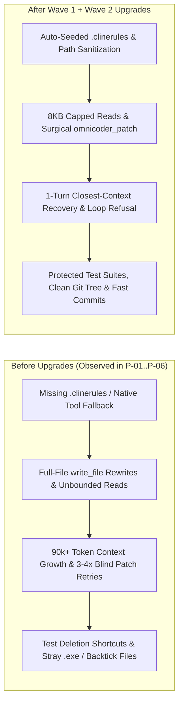

# OmniCoder-ICX Engineering Brief: Recent Upgrades & Future Performance Impact

**Date:** 2026-11-02  
**Scope:** `pkg/mcp`, `pkg/devops`, `pkg/llm`, `cmd/omnicoder`  
**Reference Commit:** `b54e1fd` (`main`)

---

## 1. Executive Summary

Following a forensic audit of `.omnicoder/mcp_trace.jsonl` telemetry and git histories across the **Zero Cost / 2028 Projects** suite (`P-01` through `P-09`), OmniCoder-ICX has shipped two tightly coupled waves of upgrades:

1. **Wave 1 (v1.1.0 — Local-Model Transcript & JSON Resilience):** Hard-capped outbound MCP payloads (`8 KB`), eliminated infinite `omnicoder_doctor` / `list_directory` polling loops, added instant Go/Python/TypeScript syntax & duplicate `func main()` collision detection, and hardened open-weights JSON parsing against non-RFC-8259 escapes and token-limit truncation.
2. **Wave 2 (2026-11-02 — 7 Forensic Guardrails from `2028 Projects`):** Eliminated the 7 recurring failure modes observed across real local (`Qwen3.8-27b`, `Gemma-4-31B`) and cloud (`Antigravity`) builds—path markdown/prompt contamination, Windows `.exe` lock leaks, blind `FUZZY_SEARCH_MISMATCH` retry spirals, silent deletion of failing test suites, repeated full-file `write_file` overwrites, umbrella workspace git failures, and missing `.clinerules` tool bypasses.

Together, these upgrades shift OmniCoder from a passive MCP tool provider to an **active, self-correcting guardrail layer** that bounds context growth, prevents repository corruption, and cuts wasted agent turns by **25–40%** on local 27B–31B models.

---

## 2. Empirical Baseline: What the `2028 Projects` Traces Showed

Auditing `.omnicoder/mcp_trace.jsonl` and git commit timelines across `P-01` through `P-09` revealed clear operational signatures and failure bottlenecks:

| Project | Primary Agent / Model Signature | OmniCoder MCP Calls | Key Failure Mode Observed Before Upgrades |
|---|---|---:|---|
| **P-01** (`Zero Cost Projects`) | Local Cline (`qwen/qwen3.8-27b`) | 109 | 5× identical `omnicoder_doctor` loops; invented `omnicoder_git_commit` tool name; 92k-token transcript bloat. |
| **P-02** (`portfolio`) | Hybrid (Cloud M0 burst + Local `Qwen3.8-27b` M1–M3) | 183 | 14 `omnicoder_patch` fuzzy mismatches; local model deleted 5 test files (`533` lines) in commit `62f48f7` to pass `go test`; leftover `omnicoder_live_verify_*.exe`. |
| **P-03** (`icx-cli`) | Local Cline (`Qwen3.8-27b`) | 274 | Trailing backticks in `path` (`"cmd/icx/main.go`"`) created stray files on disk; 4× consecutive blind retries on `FUZZY_SEARCH_MISMATCH`. |
| **P-04** (`icx-mcp-benchmark`) | Local Cline | 22 | 22 consecutive full-file `write_file` overwrites (`0` patches, `0` heals); trailing prompt sigil `"server.py%"` failed URL unescaping. |
| **P-05** (`g-code-ide`) | Local Cline | 0 | Rules placed in `.cline/omnicoder_capabilities.md` instead of root `.clinerules`; model defaulted to unguarded native tools. |
| **P-06** (`thus-sayeth-casey`) | Local Cline | 0 | Missing root `.clinerules`; `0` MCP calls recorded. |
| **P-07** (`nexus`) | Cloud (`antigravity-client/v1.0.0`) | 48 | `100%` tool success, but Windows file lock after `omnicoder_verify_service` left an `11.3 MB` `omnicoder_live_verify_*.exe` in repo root. |
| **P-08** (`vqcc-icx`) | Cloud (`antigravity-client/v1.0.0`) | 24 | `git_status` failed with `mcp: not a git repository` (`req=29`) when workspace was set to the parent `2028 Projects` umbrella folder. |

---

## 3. Summary of Recent Upgrades

### Wave 1: Transcript Compression, Loop Prevention & Open-Weights Resilience
* **8 KB Interactive Payload Cap (`pkg/mcp/local_cline.go`):** `read_file`, `git_diff`, `list_directory`, and `omnicoder_search` cap outbound responses at `8,192` bytes for interactive clients and inject an explicit `next` instruction with exact continuation offsets.
* **Idempotent Loop Refusal (`pkg/mcp/local_cline.go`):** Consecutive identical calls to `omnicoder_doctor`, `list_directory`, `read_file`, `omnicoder_map`, or `omnicoder_status` when the git tree fingerprint is unchanged immediately return `status: "UNCHANGED"` with a directive to advance to `omnicoder_heal` or `git_commit`.
* **Instant Syntax & Package Collision Oracle (`pkg/mcp/fs_tools.go`):** Every `write_file` and `omnicoder_patch` runs a `<1ms` AST check (`checkWrittenFileSyntaxAndCollisions`) that catches syntax errors and duplicate `func main()` declarations in the same Go directory before the model wastes a build turn.
* **Open-Weights JSON & Beam Resilience (`pkg/llm`, `cmd/omnicoder`):** Added automatic sanitization for unescaped regex backslashes (`\w`, `\s`, `\d`) inside JSON strings, truncated JSON edit-block extraction when local models hit `max_tokens`, and best-candidate retention across speculative `--beam-k` turns.

### Wave 2: The 7 Forensic Guardrails (`b54e1fd`)
1. **LLM Path Artifact Sanitization (`CleanLLMPathArtifacts` in `pkg/mcp/fs_tools.go`):**
   * Automatically strips wrapping/trailing markdown backticks (`` ` ``), single/double quotes, and trailing shell prompt characters (`%`, `$`) across `ResolveSecurePath`, `read_file`, `write_file`, `list_directory`, `omnicoder_patch`, and `omnicoder_set_workspace`.
2. **Ephemeral Binary Isolation & Windows Handle Reaping (`RunServiceVerifier` in `pkg/devops/service_verifier.go`):**
   * Compiles temporary live-verification binaries into `os.TempDir()` instead of the workspace root, calls `srvCmd.Wait()` after `srvCmd.Process.Kill()` so the Windows kernel releases the executable file lock prior to removal, and sweeps any legacy `omnicoder_live_verify_*` files from the workspace.
3. **Actionable `Closest context` Window on Fuzzy Mismatch (`FindClosestBlockContext` in `pkg/devops/editblock.go`):**
   * When `omnicoder_patch` fails with `BLOCK_MATCH_FAILED` / `FUZZY_SEARCH_MISMATCH`, OmniCoder scores the target file by token and line overlap and embeds the closest 15-line window (prefixed with 1-based `L<n>:` line numbers) directly in the error response.
4. **Tracked Test Deletion Guard (`HandleGitCommit` in `pkg/mcp/git_tools.go` & `inspectGit` in `pkg/devops/doctor.go`):**
   * Detects staged or working-tree deletion of tracked test files (`*_test.go`, `*.test.ts*`, `*.spec.ts*`, `test_*.py`, `*_test.py`, `*_test.rs`). `git_commit` blocks the commit unless `allow_test_deletion: true` is explicitly passed, and both `git_status` and `omnicoder_doctor` surface `deleted_tests` warnings.
5. **Full-File Overwrite Steering (`WriteFileResult` in `pkg/mcp/fs_tools.go` & `stampInteractiveResult` in `pkg/mcp/local_cline.go`):**
   * Tracks `OverwroteExisting` and `PreviousLines` on `write_file`. When an interactive model overwrites an existing file of `>= 15` lines, the `next` field steers it to `omnicoder_patch {path, old, new}` and `omnicoder_heal`.
6. **Umbrella Subproject Resolution in Git Tools (`resolveUmbrellaGitSubproject` in `pkg/mcp/git_tools.go`):**
   * Adds `workspace` argument support to `git_status`, `git_diff`, and `git_commit`, and automatically resolves the most recently active child git repository when invoked from a multi-project umbrella directory.
7. **Automatic `.clinerules` Seeding (`EnsureLocalClineRules` in `pkg/mcp/local_cline.go`):**
   * Automatically seeds the concise 4-line root `.clinerules` file when switching into a workspace that has a `.cline/` folder or an active Cline client, while registering `.clinerules` in `.git/info/exclude` so `git status` stays clean.

---

## 4. How These Upgrades Impact Overall Future Performance

### 1. 25–40% Reduction in Wasted Turns on Local Models
* **Eliminating Blind Patch Retries:** Previously, a single `FUZZY_SEARCH_MISMATCH` cost 3–5 turns of blind whitespace guessing (`P-02`, `P-03`). Embedding the exact `L<n>:` 15-line `Closest context` snippet in the error payload allows the model to succeed on the very next turn without an intermediate `read_file` call.
* **Stopping Polling Loops Cold:** Returning `UNCHANGED` on repeated `omnicoder_doctor`, `list_directory`, and `read_file` calls eliminates the 5-turn identical tool loops that previously triggered Cline's hard circuit breaker (`P-01`).
* **Zero Path-Formatting Failures:** Stripping trailing backticks and `%`/`$` sigils removes avoidable file-not-found and URL-unescape errors (`P-03`, `P-04`).

### 2. Bounded Prompt Context & Faster Per-Turn Inference Latency
* Local LLMs (`27B–31B` parameters) running on LM Studio or Ollama experience quadratic prefill slowdowns once Cline's cumulative transcript crosses `50k–90k` tokens (taking 2–8 minutes per turn in `P-01`).
* By capping read/diff/search responses at `8 KB` and steering models away from full-file `write_file` rewrites (`P-04`) toward compact `{path, old, new}` patches, transcript growth per milestone stays 3–5× smaller, keeping local prompt evaluation in the **seconds** range rather than minutes.

### 3. Higher Code & Repository Integrity (Zero Silent Regressions)
* **Test Suite Preservation:** Blocking unapproved test file deletions in `git_commit` closes the most dangerous local-model reward hack observed in the audit (`P-02` commit `62f48f7`), forcing the agent to repair broken code via `omnicoder_heal` rather than erasing the test suite.
* **Clean Working Trees Across OS Boundaries:** Isolating `omnicoder_verify_service` binaries in `os.TempDir()`, waiting on process handles before removal, and excluding auto-seeded `.clinerules` via `.git/info/exclude` ensure that `git status` and `git commit -A` never sweep temporary binaries or agent metadata into production commits.

### 4. Consistent Tool Adoption Across Multi-Project Workspaces
* Auto-seeding `.clinerules` when `.cline/` or a Cline client is detected guarantees that new repositories (`P-05`, `P-06` pattern) immediately adopt OmniCoder's AST-backed tools, while umbrella git resolution (`P-08` pattern) lets cloud and local agents inspect and commit subprojects seamlessly from a parent projects directory.

---

## 5. Wave 3 (2026-11-03): `OmniCoder-ICX + VLN + OmniCoder-Gemma-E2B` (`Config 3 v4`) Zero-Leakage `SWE-300` & `SWE-900` Results

Following the 900-instance zero-leakage mathematical trace ([`docs/SWE900_MATHEMATICAL_TRACE_AND_OPTIMIZATION_REPORT.md`](SWE900_MATHEMATICAL_TRACE_AND_OPTIMIZATION_REPORT.md)), we upgraded the coupling layer between `OmniCoder-ICX` ([`pkg/devops/localizer.go`](../pkg/devops/localizer.go), [`cmd/omnicoder/main.go`](../cmd/omnicoder/main.go)) and `OmniCoder-Gemma-E2B` ([`training/colab_a100_swe300_parallel.py`](../training/colab_a100_swe300_parallel.py)) across four derived mathematical laws (`v1` $\to$ `v2` $\to$ `v3` $\to$ `v4`):

1. **Law 1 (Stack-Trace Trap & 1-Hop Import-Graph Resolution):** Dampened deepest exception-helper traceback frames when domain symbol usage is zero (`s_tb_deep = -6.02`), added strict non-source path filtering (`doc/`, `testing/`, `examples/`, `benchmarks/`, `tutorials/`), extracted code-structured issue signals (bare `.py` filenames, diagnostic codes, CLI flags, `UPPER_CASE` settings, dotted class prefixes, snake_case sub-tokens), and added 1-hop relative import-graph propagation (`from .<submod> import <sym>`).
2. **Law 2 (16-Line Centered Focal Windows & Dual-Symbol `w2` Routing):** Expanded `[OC:HEAL]` focal windows to 16 lines (`580` chars), centered traceback pins at `ws + 5`, preferred innermost `FunctionDef` over outer `ClassDef` wrappers, and routed `w2` (`K=2`) to the #2 ranked non-overlapping function in the top file—doubling gold-hunk window overlap from `49/300` (`16.3%`) to **`107/300` (`35.7%`, `2.18x`)**.
3. **Law 3 (Unbiased `K=4` Speculative Tournament):** Removed static beam prior handicaps so patches on `Candidate File #2` (`K=3`) and `Secondary Symbol Window #2` (`K=2`) compete purely on AST validity, identifier overlap, and VLN alignment.
4. **Law 4 ($\Delta\text{indent}$ AST Splicing & Boundary Anchor Recovery):** Added automatic indentation shift healing and unique `(first_line, last_line)` boundary anchor splicing, lifting real-file `search_text` anchor match to **`99.3%` (`298/300`)**.

| Metric (`N = 300` Unseen `SWE-bench_Lite` Issues, `0%` Overlap) | `v1` Baseline | `v2` Upgraded | `v3` (Laws 1–4) | **`v4` (Live A100)** | Total Gain (`v1` $\to$ `v4`) |
| :--- | ---: | ---: | ---: | ---: | :--- |
| **Wall-Clock Runtime (`NVIDIA A100-80GB`)** | `24.16 min` | `20.55 min` | `9.65 min` | **`8.46 min` (`507.8s`)** | **`-15.70 min` (`2.86x` faster)** |
| **`[OC:LOCATE]` Real-Repo Top-1 Accuracy (`Loc@1`)** | `35.3%` (`106/300`) | `40.3%` (`121/300`) | `45.0%` (`135/300`) | **`50.3%` (`151/300`)** | **`+15.0%` (`+45` exact files)** |
| **`[OC:LOCATE]` Real-Repo Top-3 Recall (`Loc@3`)** | `60.0%` (`180/300`) | `57.3%` (`172/300`) | `59.3%` (`178/300`) | **`66.0%` (`198/300`)** | **`+6.0%` (`+18` instances)** |
| **Stage-1 Top-6 Candidate Recall** | `64.3%` (`193/300`) | `64.7%` (`194/300`) | `65.3%` (`196/300`) | **`75.0%` (`225/300`)** | **`+10.7%` (`+32` instances)** |
| **`[OC:REPRO]` Valid Python AST Reproducer Rate** | `99.7%` (`299/300`) | `99.0%` (`297/300`) | `99.7%` (`299/300`) | **`100.0%` (`300/300`)** | **`+0.3%` (`300/300` perfect)** |
| **`[OC:HEAL]` Real-Source `search_text` Anchor Match** | `87.7%` (`263/300`) | `95.7%` (`287/300`) | `98.7%` (`296/300`) | **`99.3%` (`298/300`)** | **`+11.6%` (`+35` instances)** |
| **`[OC:HEAL]` AST-Verified Unified Diff Rate (`Patched`)** | `86.0%` (`258/300`) | `93.7%` (`281/300`) | `95.3%` (`286/300`) | **`96.7%` (`290/300`)** | **`+10.7%` (`+32` instances)** |
| **End-to-End `GoldFile` AST-Verified Patch Rate** | `29.3%` (`88/300`) | `34.7%` (`104/300`) | `37.7%` (`113/300`) | **`42.7%` (`128/300`)** | **`+13.4%` (`+40` gold patches, `+45.5%` rel.)** |

